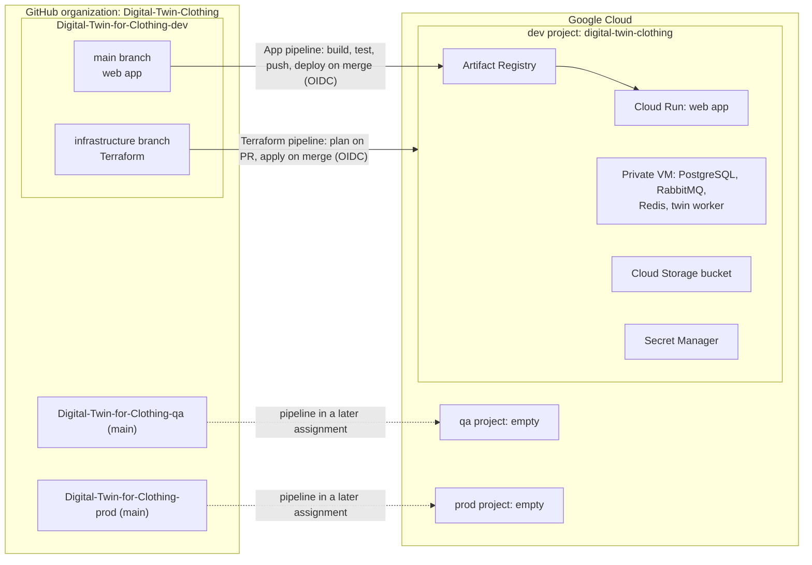
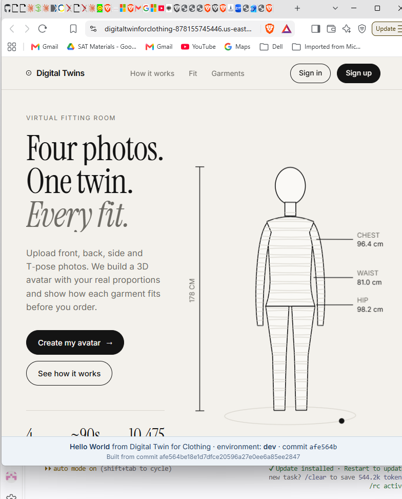
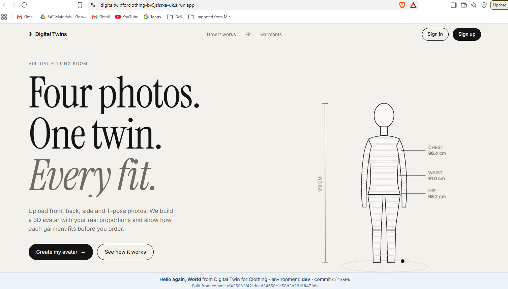
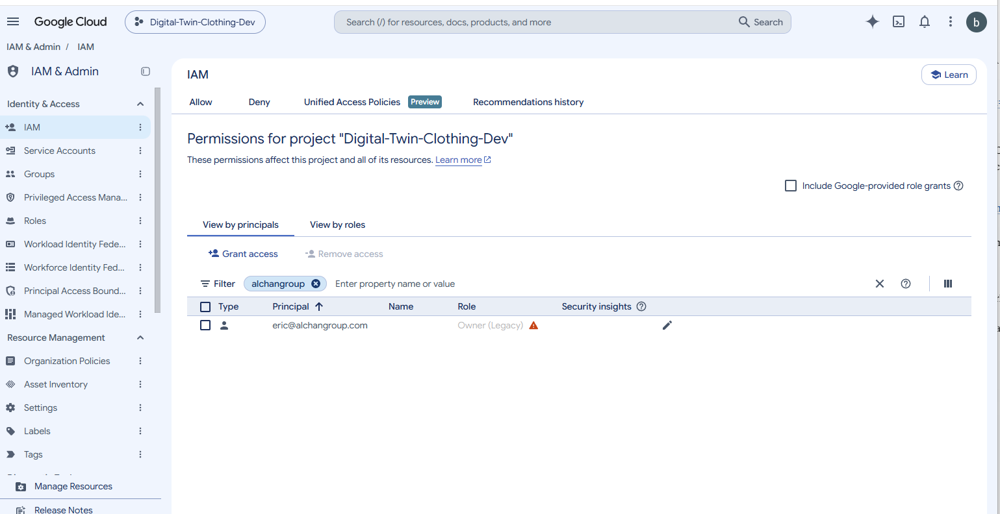
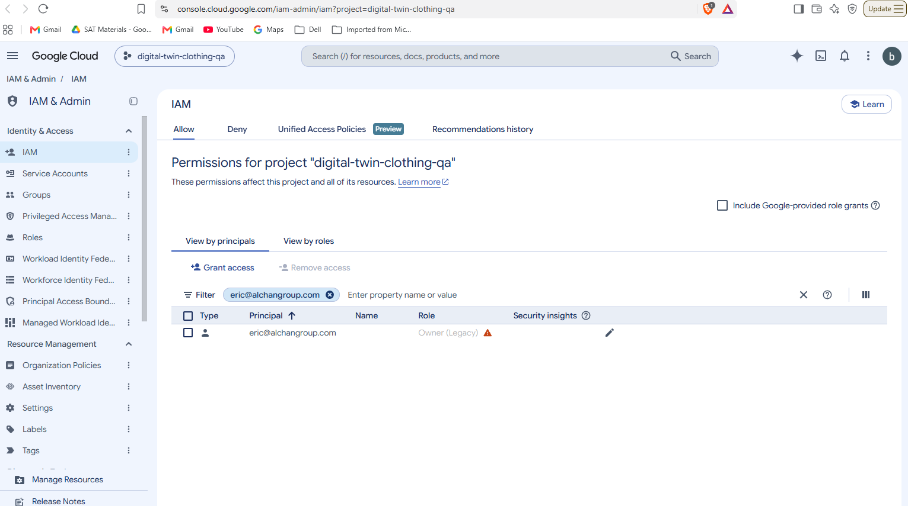

# Digital Twin for Clothing: Delivery Platform (dev)

This is the **dev** repository of the Digital Twin for Clothing startup and the front door for the *Repositories, Cloud Environments and CI/CD* assignment. The `infrastructure` branch holds the Terraform that builds the dev environment. The `main` branch holds the web app, which is deployed to dev on every merge. Code is later promoted to the [QA](https://github.com/Digital-Twin-Clothing/Digital-Twin-for-Clothing-qa) and [Prod](https://github.com/Digital-Twin-Clothing/Digital-Twin-for-Clothing-prod) repositories.

**Hello World URL:** https://digitaltwinforclothing-878155745446.us-east4.run.app

The bar at the bottom of that page shows the greeting, our startup name, the environment (`dev`) and the commit SHA the running image was built from. It started as "Hello World"; the greeting-change pull request below changed it to "Hello again, World", and the new text and SHA appeared with no manual step.

## Team

| Name | GitHub | Role |
|---|---|---|
| Kritika Pant | [pkritika](https://github.com/pkritika) | Project management, dev work |
| Bijay Pandey | [bijay299](https://github.com/bijay299) | Project management, dev work |
| Prashant Timalsina | [tprashant-21](https://github.com/tprashant-21) | CI/CD, cloud setup, DevOps |
| Niya Traynham | [niyaTraynhamn](https://github.com/niyaTraynhamn) | CI/CD, cloud setup, DevOps; prod environment setup |
| Basanta Baral | [basanta2029](https://github.com/basanta2029) | CI/CD, cloud setup, DevOps; QA environment setup; documentation |

## Cloud provider: Google Cloud

We chose Google Cloud for four reasons:

1. **It fits the free budget.** Each member gets $300 in free credits, and Cloud Run scales to zero, so an idle dev environment costs almost nothing.
2. **It matches our architecture.** Cloud Run runs our containers without a cluster to manage, and Cloud Storage, Artifact Registry and Secret Manager cover the storage, image and secret needs of our design.
3. **Keyless pipelines.** Workload Identity Federation lets GitHub Actions sign in with short-lived OIDC tokens, so no cloud keys are stored in GitHub.
4. **It is easy for the team.** Everyone already has a Google account, and Cloud Shell gives each of us a ready terminal with `gcloud` in the browser.

## Environments

| Environment | Project ID | Project number | Repository | Contents now |
|---|---|---|---|---|
| dev | `digital-twin-clothing` | 878155745446 | [Digital-Twin-for-Clothing-dev](https://github.com/Digital-Twin-Clothing/Digital-Twin-for-Clothing-dev) | Everything below, built by Terraform |
| qa | `digital-twin-clothing-qa` | 41826866945 | [Digital-Twin-for-Clothing-qa](https://github.com/Digital-Twin-Clothing/Digital-Twin-for-Clothing-qa) | Empty, ready for promotion |
| prod | `digital-twin-clothing-prod` | 1084938837648 | [Digital-Twin-for-Clothing-prod](https://github.com/Digital-Twin-Clothing/Digital-Twin-for-Clothing-prod) | Empty, ready for promotion |

**Access.** Each member signs in with their own Google account; there are no shared logins. Developers have the access their role needs in dev and **Viewer** (read-only) in qa and prod. eric@alchangroup.com is **Owner** on all three projects (screenshots under Evidence). The pipelines use their own service account, never a person's login.

**Budget.** A **$300** budget (equal to the free credit) with email alerts to the whole team at **50%** and **90%**. The qa project has no billing linked yet; it stays empty until its pipeline is added in a later assignment.

**Labels.** Every dev resource that supports labels carries `environment=dev` and `project=digital-twin-for-clothing`, set once through the provider's `default_labels`. (Networks, subnets and firewall rules cannot hold labels in Google Cloud.)

## Delivery platform



**Branches and rules.** `main` and `infrastructure` are protected: changes arrive only through pull requests with at least one approval from another member, the pipeline check must pass, and nobody can bypass these rules. The QA and Prod repositories protect `main` the same way.

## Pipelines (GitHub Actions)

Both pipelines sign in to Google Cloud with **Workload Identity Federation** (OIDC). The trust is limited to this repository: the identity provider only accepts tokens where `repository == Digital-Twin-Clothing/Digital-Twin-for-Clothing-dev` (see `infra/bootstrap/main.tf` on the `infrastructure` branch). No cloud keys are stored in GitHub.

| Pipeline | Trigger | What it does |
|---|---|---|
| Infrastructure ([terraform.yml](https://github.com/Digital-Twin-Clothing/Digital-Twin-for-Clothing-dev/blob/infrastructure/.github/workflows/terraform.yml), on `infrastructure`) | Pull request into `infrastructure` | `terraform fmt -check`, `validate` and `plan` for dev; the plan is posted on the pull request and in the job summary |
| | Merge into `infrastructure` | `terraform apply` for dev with no manual steps, then a second `plan` that must report no changes |
| App ([app.yml](.github/workflows/app.yml), on `main`) | Pull request into `main` | Install, typecheck, unit tests with branch coverage, production build |
| | Merge into `main` | The same checks, then build the Docker image tagged with the commit SHA, push it to Artifact Registry, deploy it to the Cloud Run service Terraform created, and check that the live page shows the new SHA |

## Architecture to Terraform

The dev environment follows the architecture we submitted (Model and Architect of Our MVP, Section B), scaled down for cost. Open-source components run in containers in place of managed services. The Terraform lives on the `infrastructure` branch under `infra/`.

| Architecture component | Terraform | Dev sizing |
|---|---|---|
| Network and trust boundaries | `infra/modules/network` (`google_compute_network`, `google_compute_subnetwork`, two `google_compute_firewall` rules) | One VPC, one /24 subnet in us-east4. No public ingress to the VM; data ports open only to the subnet; SSH only through Identity-Aware Proxy |
| Outbound internet for private VMs | `infra/modules/network` (`google_compute_router`, `google_compute_router_nat`) | One Cloud NAT, so the VM can pull images without a public IP |
| Website and Fit API (Kubernetes in our design) | `infra/modules/cloud_run` (`google_cloud_run_v2_service`) | One Cloud Run service, 0 to 2 instances (scales to zero), 1 CPU and 512 MiB, private traffic to the VM through Direct VPC egress |
| PostgreSQL (database) | `infra/modules/data_vm` (`google_compute_instance`, container `postgres:16-alpine`) | One `e2-micro` VM with no public IP, 10 GB disk; data in a Docker volume |
| RabbitMQ (message broker) | `infra/modules/data_vm` (container `rabbitmq:3-alpine`) | Same VM |
| Redis (cache) | `infra/modules/data_vm` (container `redis:7-alpine`) | Same VM, password protected |
| Twin Worker (GPU in our design) | `infra/modules/data_vm` (container `twin-worker`) | Placeholder container on the same VM until the MVP build adds the real worker (no GPU in dev) |
| Object storage (photos, avatar files) | `infra/environments/dev/main.tf` (`google_storage_bucket.app_storage`) | One private bucket, public access prevention enforced |
| Container registry | `infra/modules/registry` (`google_artifact_registry_repository`) | One Docker repository; images tagged with the commit SHA |
| Secrets (Vault in our design) | `infra/environments/dev/secrets.tf` (`google_secret_manager_secret`, `random_password`) | Auth secret and database password, generated by Terraform, read at runtime |
| Terraform state | `infra/bootstrap` (`google_storage_bucket.terraform_state`) | One versioned bucket with public access blocked; Cloud Storage locks the state on every run |
| Keyless pipeline sign-in | `infra/bootstrap` (`google_iam_workload_identity_pool`, `google_iam_workload_identity_pool_provider`, `google_service_account`) | One pool and provider limited to this repository; one deployer service account |

**What changed from our architecture, and why.** Kubernetes became Cloud Run because the course rules forbid managed Kubernetes and Cloud Run scales to zero. The Fit API runs inside the Next.js app for now; it moves to its own service when it grows. PostgreSQL, RabbitMQ and Redis run as containers on one small VM instead of managed services. The GPU twin worker is a placeholder until the MVP build. Secret Manager replaces HashiCorp Vault. The identity provider and email service are not in dev yet; sign-in uses NextAuth credentials in the app. The Cloud Run service was first created by hand and deployed through a console-made Cloud Build trigger; Terraform has now imported the service, the trigger was deleted, and GitHub Actions is the only deploy path.

**Variables and outputs.** Names, sizes and the region come from `infra/environments/dev/dev.tfvars`. The outputs include `hello_world_url`. No passwords, keys or tokens appear in the code or in `.tfvars` files.

## One-time setup (already done)

`infra/bootstrap` was applied once by a project Owner from Cloud Shell. It turns on the needed Google Cloud APIs, creates the state bucket `digital-twin-clothing-tfstate`, the Workload Identity pool and provider, and the `github-deployer` service account. After that, every change to dev goes through the pipelines.

## Running `terraform plan` locally

1. Install Terraform **1.17.1** (the pinned version) and the Google Cloud CLI.
2. Sign in with your own account:
   ```sh
   gcloud auth application-default login
   ```
3. Run the plan (the state bucket is set in `backend.tf`):
   ```sh
   git checkout infrastructure
   cd infra/environments/dev
   terraform init
   terraform plan -var-file=dev.tfvars
   ```

Do not run `apply` locally; merges into `infrastructure` apply through the pipeline.

## Evidence

| Evidence | Link |
|---|---|
| Merged infrastructure pull request (plan posted on it) | https://github.com/Digital-Twin-Clothing/Digital-Twin-for-Clothing-dev/pull/11 |
| Its successful apply run (with the second plan showing no changes) | https://github.com/Digital-Twin-Clothing/Digital-Twin-for-Clothing-dev/actions/runs/44002703940 |
| App deployment run | https://github.com/Digital-Twin-Clothing/Digital-Twin-for-Clothing-dev/actions/runs/44004182912 |
| Greeting-change pull request | https://github.com/Digital-Twin-Clothing/Digital-Twin-for-Clothing-dev/pull/14 |
| Second infrastructure pull request | https://github.com/Digital-Twin-Clothing/Digital-Twin-for-Clothing-dev/pull/15 |

The greeting before and after the greeting-change pull request (same URL, new text and new commit SHA, deployed by the pipeline):

| Before | After |
|---|---|
|  |  |

Instructor access, one screenshot per environment (IAM page showing eric@alchangroup.com as Owner):

| Environment | Screenshot |
|---|---|
| dev |  |
| qa |  |
| prod |  |

The instructor's Owner invitations have been sent and show as pending (grey role with a warning sign) until he accepts them.
---

## About the app

**Digital Twins** is a 3D virtual fitting room for the web. Shoppers create a 3D avatar from four photos (front, back, left and right), try on clothing in a 3D viewer and get a size recommendation. The MVP is built on top of this platform; this assignment only proves the delivery path works.

### Tech stack (MVP)

| Layer | Technologies |
|---|---|
| Frontend | Next.js, TypeScript, Tailwind CSS, React Three Fiber / Three.js |
| Backend | Python, FastAPI |
| Computer vision and ML | OpenCV, MediaPipe, SMPL-X, PyTorch |
| 3D garments | Blender, GLB/glTF |

### Run the app locally

```sh
npm ci
npm test            # unit tests with branch coverage
npm run dev         # http://localhost:3000
```

With Docker (the same image the pipeline builds):

```sh
docker build --build-arg COMMIT_SHA=local -t digital-twins-web .
docker run --rm -p 8080:8080 -e APP_ENV=local -e AUTH_TRUST_HOST=true \
  -e AUTH_SECRET="$(openssl rand -base64 32)" digital-twins-web
```

Never commit secrets.
