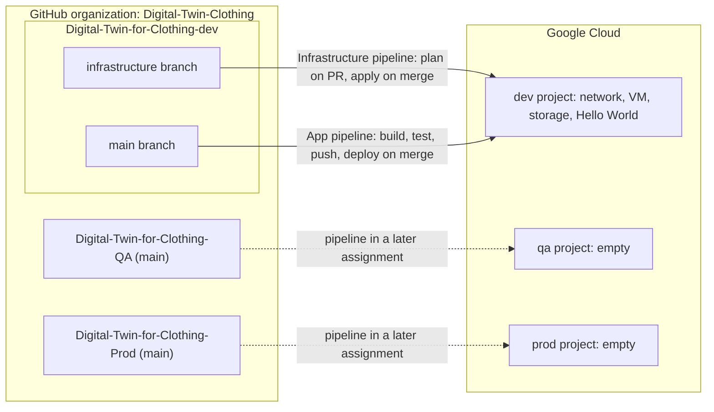

# Digital Twin for Clothing: Delivery Platform (dev)

This is the **dev** repository of the Digital Twin for Clothing startup and the front door for the *Repositories, Cloud Environments and CI/CD* assignment. It holds the Terraform that builds the dev environment (on the `infrastructure` branch), the CI/CD pipelines, and the Frontend Prototype (on `main`).

## Purpose of this repo

This repository is where all developers add features and fix bugs. Every change reaches `main` or `infrastructure` through a reviewed pull request, and from here code is promoted to the [QA](https://github.com/Digital-Twin-Clothing/Digital-Twin-for-Clothing-QA) and then the [Prod](https://github.com/Digital-Twin-Clothing/Digital-Twin-for-Clothing-Prod) repositories.

## Team

| Name | GitHub | Role |
|---|---|---|
| Kritika Pant | [pkritika](https://github.com/pkritika) | Project management, dev work |
| Bijay Pandey | [bijay299](https://github.com/bijay299) | Project management, dev work |
| Prashant Timalsina | [tprashant-21](https://github.com/tprashant-21) | CI/CD, cloud setup, DevOps |
| Niya Traynham | [niyaTraynhamn](https://github.com/niyaTraynhamn) | CI/CD, cloud setup, DevOps; prod environment setup |
| Basanta Baral | [basanta2029](https://github.com/basanta2029) | CI/CD, cloud setup, DevOps; QA environment setup; documentation |

## Cloud provider: Google Cloud

We chose Google Cloud for five reasons:

1. **It fits the free budget.** GCP provides with $300 free credits trail for each person on the group.
2. **It is easy for the team.** Everyone already has a Google account, the console is approachable for new members and the UI is user friendly.

## Environments

| Environment | Project name | Project ID | Project number | Repository | Contents now |
|---|---|---|---|---|---|
| dev | Digital-Twin-Clothing-Dev | `digital-twin-clothing` | 878155745446 | [Digital-Twin-for-Clothing-dev](https://github.com/Digital-Twin-Clothing/Digital-Twin-for-Clothing-dev)
|
| qa | digital-twin-clothing-qa | `digital-twin-clothing-qa` | 41826866945 | [Digital-Twin-for-Clothing-QA](https://github.com/Digital-Twin-Clothing/Digital-Twin-for-Clothing-QA)
|
| prod | Digital-Twin-Clothing-Prod | `digital-twin-clothing-prod` | 1084938837648 | [Digital-Twin-for-Clothing-Prod](https://github.com/Digital-Twin-Clothing/Digital-Twin-for-Clothing-Prod)
|

**Access.** Each member signs in with their own Google account; there are no shared logins. Developers have the access their role needs in dev and **Viewer (read-only)** in qa and prod. eric@alchangroup.com is **Owner** on all three projects.

**Budget.** A **$300** budget (equal to the free credit) with email alerts to the whole team at **50%** and **90%**. The qa project has no billing linked yet; it stays empty until its pipeline is added in a later assignment.

## Delivery platform



**Branches and rules.** In this repository, `main` (app) and the long-lived `infrastructure` branch (Terraform) are protected: changes arrive only through pull requests with at least one approval from another member, and the pipeline must pass before merging. The QA and Prod repositories protect `main` the same way.

**Pipelines (GitHub Actions).**

| Pipeline | Trigger | Steps | Status |
|---|---|---|---|
| Infrastructure ([terraform-ci.yml](.github/workflows/terraform-ci.yml)) | Pull request into `infrastructure` | `terraform fmt -check`, `validate` | Running |
| | Pull request into `infrastructure` | `terraform plan` for dev, shown in the job summary, with OIDC sign-in | In progress |
| | Merge into `infrastructure` | `terraform apply` for dev, no manual steps | In progress |
| App | Merge into `main` | Build the Docker image, run a test, push to Artifact Registry tagged with the commit SHA, deploy to the dev VM | In progress |

Both pipelines sign in to Google Cloud with Workload Identity Federation, trusted only for this repository.

## Front end 

**URL:** https://digitaltwinforclothing-878155745446.us-east4.run.app
## Architecture to Terraform

The dev environment follows the architecture we submitted, scaled down for cost and using open-source components in place of managed services.

| Architecture component | Terraform | Dev sizing | Status |
|---|---|---|---|
| Network (VPC + subnet) | `infra/modules/network` (`google_compute_network`, `google_compute_subnetwork`) | One custom VPC, one /24 subnet in us-central1 | In Terraform |
| Ingress / firewall | `infra/modules/network` (`google_compute_firewall`) | HTTP (port 80) only, to instances tagged `dev-web` | In Terraform |
| App compute (in place of Kubernetes) | Cloud Run service (`google_cloud_run_v2_service`) | One service, minimum 0 instances (scales to zero), smallest CPU and memory that run the app | Planned (replaces the temporary VM below) |
| Temporary host | `infra/modules/compute` (`google_compute_instance`) | One `e2-micro` VM, Debian 12, 20 GB standard disk, us-central1-a | In Terraform; removed when Cloud Run is added |
| Object storage (photos, avatar GLB files) | `infra/environments/dev/main.tf` (`google_storage_bucket.app_storage`) | One private bucket | In Terraform |
| Container registry | Artifact Registry repository | One Docker repository | Planned (app pipeline) |
| Terraform state | `infra/bootstrap` (`google_storage_bucket.terraform_state`) | One versioned bucket, public access blocked, native locking | In Terraform |

## Running `terraform plan` locally

1. Install Terraform **1.17.1** (the pinned version) and the Google Cloud CLI.
2. Sign in with your own account:
   ```sh
   gcloud auth application-default login
   ```
3. Initialize with the remote state bucket (created once by `infra/bootstrap`) and run the plan:
   ```sh
   cd infra/environments/dev
   terraform init -backend-config="bucket=<state-bucket-name>" -backend-config="prefix=dev"
   terraform plan -var-file=dev.tfvars
   ```
## Evidence

| Evidence | Link |
|---|---|
| Merged infrastructure pull requests | [#6 Terraform for the dev environment](https://github.com/Digital-Twin-Clothing/Digital-Twin-for-Clothing-dev/pull/6) · [#7 Terraform CI workflow](https://github.com/Digital-Twin-Clothing/Digital-Twin-for-Clothing-dev/pull/7) |
| Infrastructure pipeline runs | [Terraform CI runs](https://github.com/Digital-Twin-Clothing/Digital-Twin-for-Clothing-dev/actions/workflows/terraform-ci.yml) |
| Apply run | https://github.com/Digital-Twin-Clothing/Digital-Twin-for-Clothing-dev/actions/runs/41132685171 |
| App deployment run | https://github.com/Digital-Twin-Clothing/Digital-Twin-for-Clothing-dev/pull/5 |
| Greeting-change pull request | https://github.com/Digital-Twin-Clothing/Digital-Twin-for-Clothing-dev/pull/8 |

---

## About the app

**Digital Twins** is an interactive 3D virtual fitting room for the web. Users create a personalized 3D avatar from four photos (front, back, side and T-pose side), then try on digital garments in a 360° viewer. The app checks how each garment fits their body and recommends a size before they buy.

The goal is to take the guesswork out of online clothes shopping. Instead of relying on generic size charts, shoppers see clothes on a body that matches their real proportions and get a fit assessment for each region (chest, waist, hips and so on).

### Features

- **Avatar from 4 photos.** Guided photo capture with pose checks on the device, so bad photos are caught before upload.
- **3D body reconstruction.** A parametric SMPL-X body model is fitted to the photos and scaled to the user's real height, producing an avatar and body measurements.
- **Virtual try-on.** Rigged 3D garments are bound to the avatar's skeleton and shown in an interactive 360° viewer.
- **Fit assessment and size prediction.** Avatar measurements are compared against each garment's size chart to show where it's tight, good or loose, plus a recommended size.
- **Privacy first.** Photos are stored privately and users can delete their photos and avatar at any time.

### How it works

1. **Capture.** The user takes or uploads four photos. MediaPipe checks the pose and framing in the browser.
2. **Detect.** Pose landmarks and a body mask are extracted from each photo.
3. **Reconstruct.** A GPU job fits an SMPL-X body to all four views and exports the avatar (GLB) and its measurements.
4. **Try on.** Garments created and rigged in Blender are loaded onto the avatar using Linear Blend Skinning, with collision correction.
5. **Fit.** The app compares body measurements against garment size charts and recommends the best size.

### Tech stack (MVP)

| Layer | Technologies |
|---|---|
| Frontend | Next.js, TypeScript, Tailwind CSS, React Three Fiber / Three.js |
| Backend | Python, FastAPI |
| Infrastructure (MVP target) | Modal (GPU inference), Supabase (auth, database, file storage); in dev these are replaced as described above |
| Computer vision & ML | OpenCV, MediaPipe (pose detection, background segmentation), SMPL-X, PyTorch |
| 3D garment pipeline | Blender, GLB/glTF, Linear Blend Skinning, collision correction |

### Docker

The repository includes a root-level `Dockerfile` that builds the Next.js app as a production container (Next.js standalone output keeps the image small). Build from the repository root:

```sh
docker build -t digital-twins-web .
```

Run it locally on port 8080 with a unique `AUTH_SECRET` (never commit secrets):

```sh
docker run --rm -p 8080:8080 \
	-e PORT=8080 \
	-e AUTH_SECRET="$(openssl rand -base64 32)" \
	digital-twins-web
```

